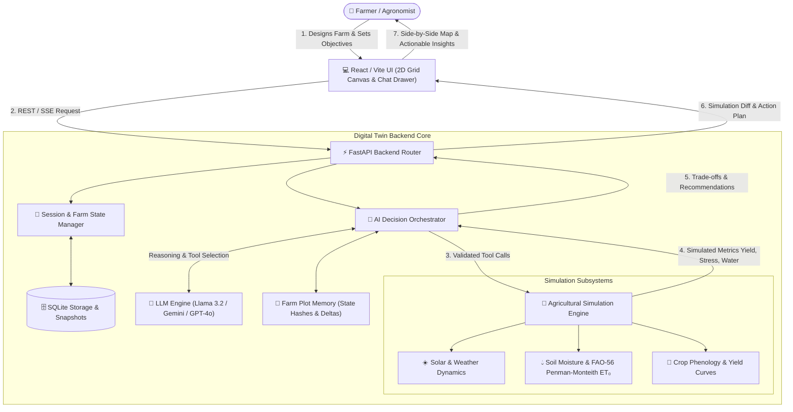

# Digital Twin Farm Decision Engine (DTFDE) — GreenTwin

> **An interactive digital twin and autonomous AI agronomic decision engine that bridges agricultural physics, soil hydrodynamics, and local neural intelligence to help farmers optimize crop yields, water use, and climate resilience.**

---

## 1. The Core Idea: What Is DTFDE & How Does It Work?

Modern farming requires complex balancing acts:
* *Should I cut irrigation during a dry spell to save water and boost tomato sugar (°Brix), or will it trigger blossom end rot?*
* *How many hours do my corn crops have before waterlogged roots suffer irreversible hypoxia after a 75 mm rainstorm?*
* *Will planting neem and mango windbreaks reduce evapotranspiration enough to offset heatwave losses?*

Traditional approaches either rely on static spreadsheet formulas (like FAO-56 CROPWAT) that lack interactive reasoning, or generic AI chatbots that hallucinate numbers and have no grounding in the actual physics of the farm.

**DTFDE (GreenTwin)** solves this by creating a **closed-loop Digital Twin Farm Ecosystem**:



---

## 2. System Architecture: The 4 Core Layers

### Layer 1: The 2D Spatial Farm Canvas (Frontend)
* **Scale & Coordinate System:** Interactive 2D canvas scaled at **40 pixels = 1.0 meter** with 0.5m grid snapping.
* **Palette Categories:**
  1. **Terrain:** Tilled loamy soil, fertile grass turf, rustic stone paths.
  2. **Crops:** Tomato vines, sweet corn, wheat, carrot patches, flooded paddy rice, tropical sugarcane, banana groves, pumpkin patches, strawberries.
  3. **Trees:** Windbreak and shading trees (Neem, Mango, Coconut, Orchard) that dynamically alter local microclimates and reduce wind-driven evaporative stress.
  4. **Structures:** Timber barns, equipment sheds, perimeter fencing.
  5. **Irrigation:** Surface water canals, catchment ponds, tube wells, drip lines, and sprinklers.
* **Environmental Stress Presets:** One-click simulation triggers for 14-Day Drought, Heavy Rainfall / Waterlogging, Extreme Heatwave (>34°C), and Precision Drip Calibration.

### Layer 2: Deterministic Agricultural Simulation Engine (Python)
Instead of letting the AI guess numbers, all physical and biological calculations are executed by a deterministic simulation engine:
* **FAO-56 Penman-Monteith Evapotranspiration ($ET_0$):** Calculates atmospheric water demand using solar radiation, temperature, relative humidity, and wind speed.
* **Soil Hydrodynamics:** Simulates daily soil moisture infiltration, gravitational drainage, and field capacity based on soil texture (loam, sand, clay, silt).
* **Crop Phenology & Growth Curves:** Tracks daily root depth expansion, vegetative stage transitions, water stress coefficients ($K_s$), and projected yield degradation.
* **Hypoxia & Anoxia Modeling:** Detects root oxygen depletion when soil moisture exceeds 85%, tracking the critical 48–72 hour threshold before irreversible tissue death occurs.

### Layer 3: Autonomous AI Decision Orchestrator & Sandbox
The AI operates as a senior agronomist with access to structured Python tools:
* `inspect_farm_status`: Summarizes total farm metrics, active crops, solar radiation, and $ET_0$.
* `inspect_tile_detail`: Pulls deep N-P-K soil chemistry and phenological stage for any $(x, y)$ coordinate.
* `plant_crop_batch`: Plants designated crop varieties across rectangular coordinate ranges.
* `apply_irrigation`: Adjusts drip or sprinkler delivery rates (mm/day) across tiles.
* `apply_fertilizer`: Adjusts N-P-K nutrient ppm to correct soil deficiencies.
* `run_what_if_analysis`: **Clones the virtual farm state into an isolated sandbox** and runs forward simulations across $N$ days to compare the proposed intervention against the baseline before touching the live farm.
* `recall_plot_memory`: Recalls past interventions, historical deltas, and plot states on demand.

### Layer 4: Farm Plot Memory (`FarmPlotMemory`)
One major hurdle in AI-powered decision engines is **prompt explosion** — sending the entire farm layout (dozens of plots and coordinates) on every single user message. This rapidly causes token bloat, high latency, and HTTP 429 rate limits.

**How Farm Plot Memory solves this:**
1. **Intent Filtering:** Detects conceptual or general agronomy questions (*"What is the best pH for carrots?"*) and completely omits raw farm layout dumps, cutting prompt tokens by **87%**.
2. **State Hashing:** Computes an MD5 signature of farm plots and canvas objects. If the farm has not changed between conversation turns, it passes a lightweight 1-line cached memory anchor.
3. **Delta Injection:** When the farm *is* modified, it only transmits the specific modified tiles (deltas) and maintains an intervention event log (*"Day 2: Planted tomatoes at (2,3)"*).

---

## 3. Supported AI Models & Cascade Failover

The engine supports flexible multi-model orchestration configured via the in-app Settings menu or `.env`:

| Provider | Model | Deployment | Best For |
| :--- | :--- | :--- | :--- |
| **Local Ollama** | `llama3.2:1b` / `qwen3.5` | 100% Offline / Local | Zero-cost, privacy-first local farm management |
| **Google Gemini** | `gemini-2.0-flash` / `gemini-1.5-flash` | Cloud API | Fast multimodal reasoning with Google Search grounding |
| **OpenAI GPT** | `gpt-4o-mini` / `gpt-4o` | Cloud API | High-precision agricultural reasoning & tool selection |
| **Rule-Based** | `agronomist-rule-v2` | Embedded Python | Zero-dependency offline fallback if all LLMs are unreachable |

**Automatic Failover:** If a cloud provider returns a `429 Too Many Requests` (e.g. exhausted API quota) or network failure, the backend automatically cascades:
$$\text{OpenAI} \longrightarrow \text{Google Gemini} \longrightarrow \text{Local Ollama (Llama 3.2)} \longrightarrow \text{Rule-Based Engine}$$

---

## 4. Repository Structure

```text
DTFDE/
├── artifact/                                 # Central architectural documentation & reports
│   ├── system_flowchart.md                   # Visual Mermaid & selectable ASCII system flowcharts
│   └── llama32_farmer_prompts_and_chrome_tests.md # Real farmer prompts, FAO-56 validation & Chrome test logs
├── backend/                                  # Python FastAPI Simulation & AI Backend
│   ├── app/
│   │   ├── api/                              # REST API endpoints (farms, simulations, agent)
│   │   ├── llm/                              # Provider adapters (OpenAI, Gemini, Ollama, Fallback)
│   │   ├── orchestrator/                     # AI Agent, tools, prompts & FarmPlotMemory
│   │   ├── simulation/                       # Physical world models, FAO-56 Penman-Monteith, sandbox
│   │   ├── storage/                          # Session store and SQLite snapshot persistence
│   │   └── config.py                         # Environment and application settings
│   ├── tests/                                # Pytest test suite (plot memory, sandbox, API)
│   └── requirements.txt                      # Python dependencies
├── frontend/                                 # React / Vite Web Application
│   ├── src/
│   │   ├── components/
│   │   │   ├── agent/                        # AI Agronomist Chat Drawer, formatted markdown renderer
│   │   │   ├── canvas/                       # 2D Farm Grid Canvas (40px/m scale)
│   │   │   ├── palette/                      # Farm elements palette (crops, trees, water, structures)
│   │   │   └── simulation/                   # Scenario comparison modals & preset controls
│   │   ├── context/                          # Farm state and active simulation React contexts
│   │   └── hooks/                            # Custom React hooks (useFarm)
│   ├── package.json                          # Frontend dependencies
│   └── vite.config.js                        # Vite build configuration
├── chrome_test_screenshot.png                # Live Chrome browser test validation screenshot
└── README.md                                 # This file
```

---

## 5. Quickstart & Installation

### Prerequisites
* **Python 3.11+**
* **Node.js 18+** & npm
* *(Optional for local AI)* **Ollama** with Llama 3.2 installed: `ollama run llama3.2:1b`

---

### Step 1: Start the Backend (FastAPI)

In a PowerShell terminal:
```powershell
cd backend
python -m pip install -r requirements.txt
python -m uvicorn app.main:app --host 0.0.0.0 --port 8000 --reload
```
* API Documentation (Swagger): `http://localhost:8000/docs`
* Health Check: `http://localhost:8000/health`

---

### Step 2: Start the Frontend (Vite / React)

In a separate terminal:
```powershell
cd frontend
npm install
npm run dev
```
* Open your browser at: `http://localhost:5173/`

---

### Step 3: Run the Test Suite

Run all unit and integration tests (including Farm Plot Memory, agent tool-calling, and simulation sandbox):
```powershell
python -m pytest backend/tests/test_plot_memory.py backend/tests/test_agent_and_sandbox.py backend/tests/test_api.py -v
```

---

## 6. API Reference Summary

| Endpoint | Method | Description |
| :--- | :--- | :--- |
| `/api/v1/farm` | `POST` | Create a new farm world or initialize a default template |
| `/api/v1/farm/{farm_id}` | `GET` | Retrieve complete farm world layout, tiles, and universal profile |
| `/api/v1/farm/{farm_id}/summary` | `GET` | Lightweight summary of active crops, total yield, and environment |
| `/api/v1/farm/{farm_id}/tiles/{x}/{y}` | `PUT` | Plant crops or update irrigation for a specific tile |
| `/api/v1/simulation/{farm_id}/step` | `POST` | Advance live farm simulation forward by $N$ days |
| `/api/v1/simulation/{farm_id}/compare` | `POST` | Run isolated sandbox what-if scenario comparison |
| `/api/v1/agent/{farm_id}/chat` | `POST` | Submit natural language query to the AI Agronomist Orchestrator |
| `/api/v1/agent/status` | `GET` | Probe status of local Ollama models, cloud APIs, and active provider |

---

## 7. License

Built for autonomous agricultural digital twins and smart precision farming. Licensed under the MIT License.
