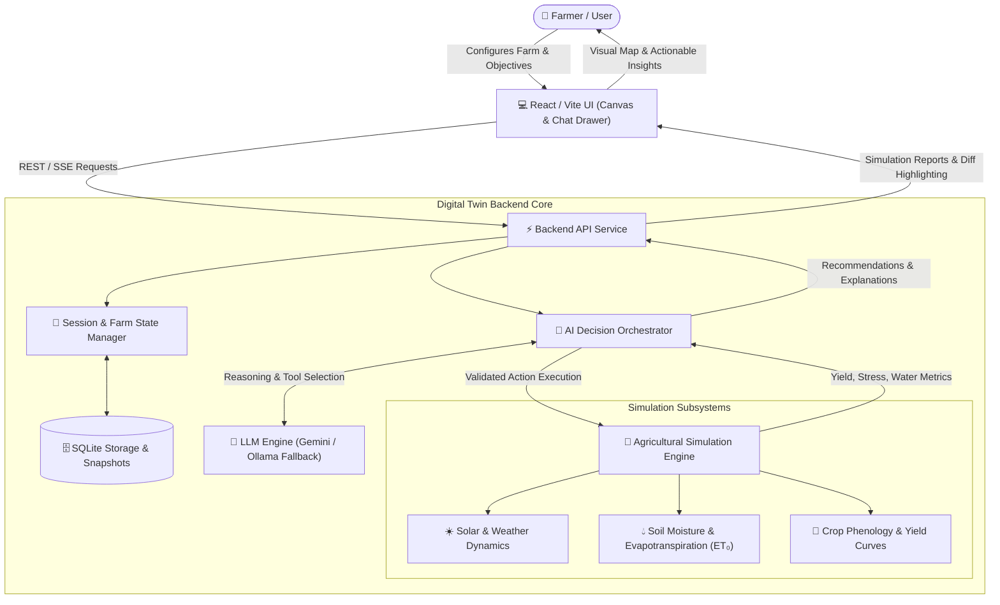
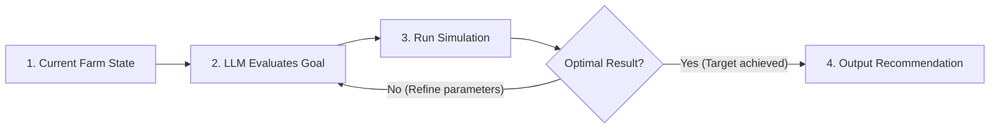

# Digital Twin Farm Decision Engine (DTFDE) — System Flowcharts & Architecture

---

## 1. High-Level End-to-End System Flowchart

### Visual Diagram (Mermaid)


### Selectable Text Flowchart (ASCII & Step Breakdown)
```text
+-----------------------------------------------------------------------------------+
|                                 1. USER / FRONTEND                                |
|  Farmer / User -> React/Vite UI (2D Farm Grid Canvas + AI Agronomist Chat Drawer) |
+-----------------------------------------------------------------------------------+
                                          |
                                          | REST API / SSE Requests
                                          v
+-----------------------------------------------------------------------------------+
|                                2. BACKEND API ROUTER                              |
|  - Receives Farm Configuration & Simulation Requests                              |
|  - Manages Session State & SQLite Persistence                                     |
+-----------------------------------------------------------------------------------+
                                          |
                                          v
+-----------------------------------------------------------------------------------+
|                            3. AI DECISION ORCHESTRATOR                            |
|  - LLM Provider: Google Gemini API with local Ollama fallback (Llama/Qwen)        |
|  - Autonomous multi-step tool reasoning: Inspect tiles, simulate sandbox edits    |
+-----------------------------------------------------------------------------------+
                                          |
                                          v
+-----------------------------------------------------------------------------------+
|                        4. AGRICULTURAL SIMULATION ENGINE                          |
|  - Solar & Climate Dynamics (Daily temperature, solar radiation, rain)            |
|  - Soil Hydrodynamics & Moisture (FAO-56 Penman-Monteith Evapotranspiration ET0)  |
|  - Crop Phenology Engine (Root depth, water stress coefficient Ks, yield impact)  |
+-----------------------------------------------------------------------------------+
                                          |
                                          v
+-----------------------------------------------------------------------------------+
|                            5. SYNTHESIS & REPORTING                               |
|  - Calculate delta: Yield Change (%), Water Demand, Pathogen & Hypoxia risks      |
|  - Return structured recommendations, actionable trade-offs, and map diffs        |
+-----------------------------------------------------------------------------------+
                                          |
                                          v
+-----------------------------------------------------------------------------------+
|                               6. FRONTEND DELIVERY                                |
|  - Interactive Side-by-Side Comparison Modal                                      |
|  - Actionable Suggestions Checklist & Real-time Canvas Metric Overlays            |
+-----------------------------------------------------------------------------------+
```

---

## 2. Autonomous Multi-Step AI Decision Loop

### Visual Diagram (Mermaid)


### Selectable Text Decision Loop
```text
[Current Farm State] 
         │
         ▼
[LLM Evaluates Goal] ──(Propose Parameter Changes: Irrigation, Crops, Soil)──► [Run Simulation Engine]
         ▲                                                                                │
         │                                                                                ▼
         └─────────────(No: Iterate within tool call budget)───────────── [Optimal Result?]
                                                                                          │
                                                                           (Yes: Target met)
                                                                                          ▼
                                                                           [Output Final Plan]
```

---

## 3. Execution Sequence & Data Flow

```text
Step 1 [User Action]:
  Farmer sets targets (e.g. drought resilience, maximize wheat yield) in the UI.

Step 2 [State Hydration]:
  Backend retrieves current tile grid (crops, soil types, moisture levels, irrigation infrastructure).

Step 3 [Tool-based AI Reasoning]:
  AI evaluates scenario stress parameters and tests micro-adjustments using sandbox tools.

Step 4 [Agricultural Physics Simulation]:
  Runs moisture depletion, heat stress, and nutrient absorption equations over N simulation days.

Step 5 [Comparison & Presentation]:
  System packages before-vs-after metrics, highlights impacted tiles, and renders recommendations.
```
