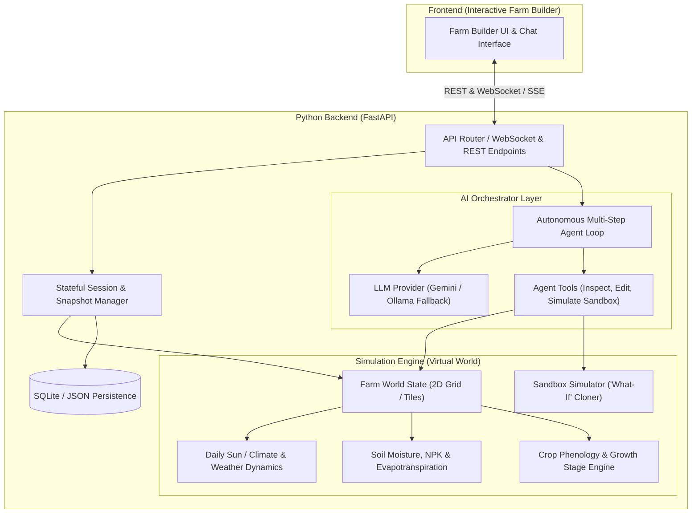

# AI-Powered Agriculture Simulation Backend - System Architecture & Specification

## 1. Executive Overview

The **AI-Powered Agriculture Simulation Backend** is a modular Python system designed to power an interactive farm builder experience. It combines a deterministic agricultural physics/biology simulation engine with an autonomous multi-step AI Orchestration Agent (powered by Google Gemini with Ollama fallback).



---

## 2. Component Specifications

### 2.1 Virtual World & Simulation Engine (`simulation/`)
The engine models a 2D tile-based farm with editable parameters and daily time-tick progression:
- **Grid Tiles (`FarmTile`)**:
  - `(x, y)` coordinates
  - **Soil State**: moisture level (%), nitrogen (N), phosphorus (P), potassium (K), pH, compaction
  - **Crop State**: crop type (e.g., Tomato, Wheat, Corn, Soybean), planted day, current growth stage (Germination, Vegetative, Flowering, Ripening, Mature), biomass, health (0-100), water stress index
  - **Infrastructure**: irrigation emitter type (Drip, Sprinkler, None), coverage rate
- **Daily Sun & Climate Engine (`EnvironmentEngine`)**:
  - Diurnal solar radiation & sunlight hours (solar angle, photoperiod, clear-sky vs overcast index)
  - Temperature curve ($T_{min}$, $T_{max}$, daily average)
  - Evapotranspiration calculated via simplified Penman-Monteith equation ($ET_0$)
  - Rainfall events and soil absorption/runoff
- **Crop Growth & Phenology Model (`CropEngine`)**:
  - Growing Degree Days (GDD) accumulation: $\text{GDD} = \max\left(0, \frac{T_{max} + T_{min}}{2} - T_{base}\right)$
  - Water stress factor ($\text{WSF} = \frac{\text{Actual Soil Moisture}}{\text{Field Capacity}}$)
  - Nutrient availability modifier
  - Projected harvest yield calculation based on cumulative stress
- **Sandbox Cloner (`SimulationSandbox`)**:
  - Creates a lightweight, in-memory deep copy of the current farm state.
  - Allows the AI to fast-forward 7, 30, or 90 days under varying treatment conditions (e.g. baseline vs +20% irrigation) to evaluate yield and stress impacts before committing changes.

---

### 2.2 Autonomous Multi-Step AI Orchestrator (`orchestrator/`)
- **Agent Loop**:
  1. **Perceive**: Ingests farm grid metadata, current day, weather forecast, and user prompt.
  2. **Plan**: Decomposes user goal into agronomic sub-tasks.
  3. **Act via Tools**:
     - `inspect_tile_status(x, y)` / `get_farm_summary()`
     - `apply_irrigation(x, y, rate_mm)`
     - `apply_fertilizer(x, y, n, p, k)`
     - `plant_crop(x, y, crop_type)`
     - `run_what_if_scenario(days, hypothetical_actions, weather_modifier)`
     - `advance_world_time(days)`
  4. **Synthesize & Respond**: Returns clear explanations with data comparing baseline vs optimized outcomes.
- **LLM Provider Strategy (`llm/`)**:
  - Primary: `Google Gemini 2.5 Flash / Pro` via `google-genai` SDK with Google Search grounding tool support.
  - Fallback: Local `Ollama` API (`llama3.1:8b`, `qwen2.5`) triggered automatically if Gemini API exceeds quotas, times out, or runs offline.

---

### 2.3 API & Session Management (`api/` & `storage/`)
- **Stateful In-Memory Session Store**:
  - Active farms indexed by `session_id` or `farm_id`.
  - In-memory simulation execution ensures sub-millisecond tick times.
  - Periodic and on-demand JSON/SQLite snapshots for save/load, reset, and undo history.
- **FastAPI Endpoints**:
  - `POST /api/v1/farm/create`: Initialize a new farm grid.
  - `GET /api/v1/farm/{farm_id}`: Retrieve full farm state.
  - `POST /api/v1/farm/{farm_id}/tick`: Advance simulation by $N$ days/steps.
  - `POST /api/v1/farm/{farm_id}/tile/update`: Directly edit tile parameters.
  - `POST /api/v1/agent/chat`: Send prompt to the AI Orchestrator with streaming response/actions.
  - `POST /api/v1/agent/what-if`: Direct endpoint to run sandbox simulation comparisons.
  - `GET /api/v1/farm/{farm_id}/export`: Export farm state snapshot.

---

## 3. Directory Layout

```
backend/
├── app/
│   ├── __init__.py
│   ├── main.py                  # FastAPI application entrypoint
│   ├── config.py                # App configuration (Gemini keys, Ollama host, defaults)
│   ├── api/
│   │   ├── __init__.py
│   │   ├── routes_farm.py       # Farm state and tile management endpoints
│   │   ├── routes_simulation.py # Day/Sun simulation tick endpoints
│   │   └── routes_agent.py      # AI orchestrator & chat endpoints
│   ├── simulation/
│   │   ├── __init__.py
│   │   ├── models.py            # Pydantic & dataclass schemas (Tile, Farm, Crop, Soil)
│   │   ├── environment.py       # Sun, solar radiation, temperature & rain models
│   │   ├── crop_growth.py       # Phenology, GDD, stress and yield models
│   │   ├── sandbox.py           # In-memory clone runner for 'what-if' forecasting
│   │   └── engine.py            # Main Farm Simulation Engine
│   ├── orchestrator/
│   │   ├── __init__.py
│   │   ├── agent.py             # Multi-step autonomous agent loop
│   │   ├── tools.py             # Tool definitions exposed to the LLM
│   │   └── prompts.py           # Agronomic system prompts & instructions
│   ├── llm/
│   │   ├── __init__.py
│   │   ├── base.py              # Abstract LLM provider interface
│   │   ├── gemini_provider.py   # Gemini API client with search tool support
│   │   ├── ollama_provider.py   # Local Ollama client
│   │   └── factory.py           # Fallback manager & provider factory
│   └── storage/
│       ├── __init__.py
│       ├── session_store.py     # In-memory session manager with thread safety
│       └── snapshot.py          # SQLite / JSON snapshot serializer
├── tests/
│   ├── test_simulation.py       # Simulation engine unit tests
│   ├── test_agent.py            # Agent tool calling & sandbox tests
│   └── test_api.py              # FastAPI endpoint integration tests
├── requirements.txt             # Dependencies (fastapi, uvicorn, pydantic, google-genai, etc.)
└── README.md                    # Setup and execution guide
```
