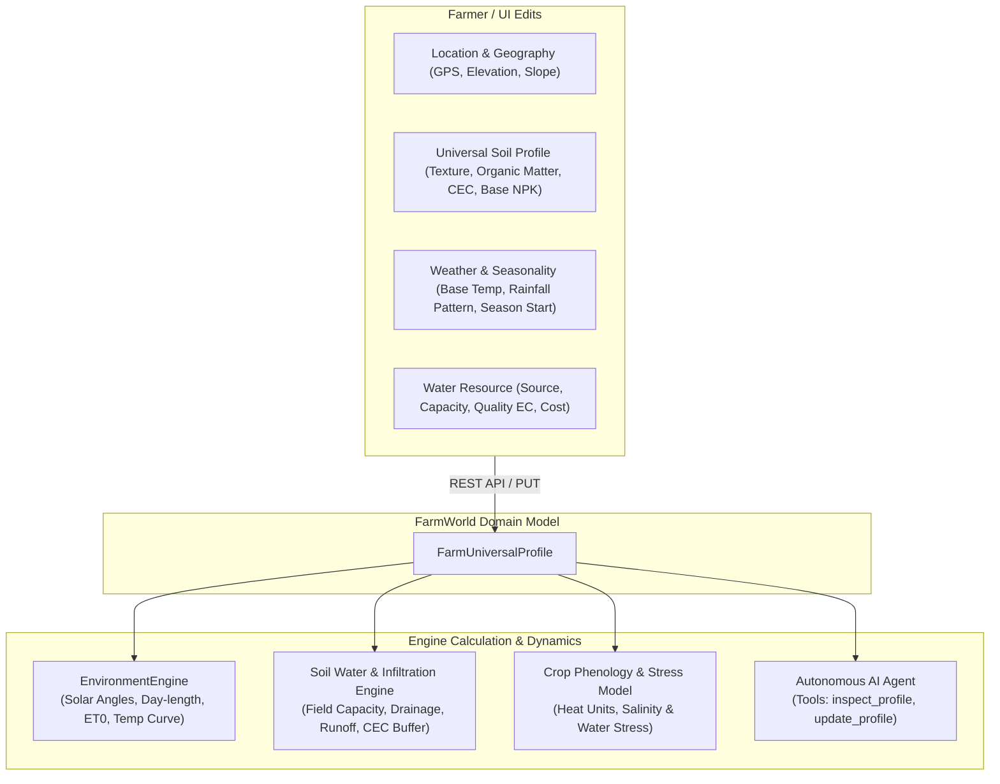

# Universal Farm Parameters Specification

## 1. Executive Summary

In the current virtual farm architecture, environmental parameters (such as solar latitude) are hardcoded, and soil states are initialized with uniform static defaults. 

This specification introduces the **`FarmUniversalProfile`** — a centralized, editable domain model representing universal agronomic, geographic, climatic, and hydrological characteristics of the entire farm plot. Any modifications made by the farmer propagate directly to the **`EnvironmentEngine`**, **`SimulationEngine`**, the **penman-monteith / hargreaves evapotranspiration models**, and the **Autonomous AI Agent**.

---

## 2. Universal Farm Parameter Architecture



---

## 3. Parameter Schema Specification

### 3.1 Geographic & Topographic Profile (`LocationProfile`)

| Field | Type | Unit | Default | Validation / Enum | Agronomic Impact |
| :--- | :--- | :--- | :--- | :--- | :--- |
| `plot_name` | `str` | - | `"Green Acres Plot 1"` | 1 - 80 chars | User display & session tracking. |
| `country` | `str` | - | `"United States"` | ISO / Standard name | Contextual regional defaults. |
| `region` | `str` | - | `"California"` | String | Climate baseline matching. |
| `latitude_deg` | `float` | `°` (Degrees) | `36.67` | `-60.0` to `+60.0` | **Solar declination**, day-length duration (photoperiod), solar noon elevation angle. |
| `longitude_deg` | `float` | `°` (Degrees) | `-121.65` | `-180.0` to `+180.0` | Solar noon offset and timezone alignment. |
| `elevation_m` | `float` | `m` | `25.0` | `-50.0` to `4500.0` | Atmospheric pressure $P$, psychrometric constant $\gamma$, adiabatic lapse rate on temperatures. |
| `climate_zone` | `str` | - | `"Csb"` | Köppen-Geiger / USDA Zone | Used by AI Agent for regional crop suitability advice. |
| `slope_pct` | `float` | `%` | `1.5` | `0.0` to `35.0` | Surface runoff multiplier ($Q_{\text{runoff}}$) vs infiltration rate. |
| `aspect_deg` | `float` | `°` (Azimuth) | `180.0` | `0.0` to `360.0` | Sun exposure multiplier (South-facing slopes in Northern Hemisphere receive higher solar irradiance). |

---

### 3.2 Baseline Soil & Geotechnical Profile (`UniversalSoilProfile`)

When new tiles are created or reset, they inherit from this universal plot baseline. Furthermore, physical constants (such as field capacity and wilting point) are derived directly from soil texture classification:

| Field | Type | Unit | Default | Validation / Options | Agronomic Impact |
| :--- | :--- | :--- | :--- | :--- | :--- |
| `texture_class` | `SoilTexture` | - | `"loam"` | `sandy`, `sandy_loam`, `loam`, `silt_loam`, `clay_loam`, `clay` | Sets default hydraulic conductivity ($K_{\text{sat}}$), field capacity, and wilting point. |
| `organic_matter_pct` | `float` | `%` | `3.2` | `0.5%` to `15.0%` | Increases water holding capacity (+1.5% moisture retention per 1% OM), natural N mineralization buffer. |
| `ph_baseline` | `float` | pH | `6.5` | `4.0` to `9.0` | Root nutrient bioavailability (optimal: 6.0–7.0 for most crops). |
| `cec_meq` | `float` | `meq/100g` | `18.0` | `2.0` to `50.0` | Cation Exchange Capacity: buffers against nutrient leaching during heavy rains. |
| `bulk_density_g_cm3` | `float` | `g/cm³` | `1.30` | `0.9` to `1.8` | Soil compaction indicator; values $> 1.55$ impede root penetration and oxygen diffusion. |
| `baseline_nitrogen_ppm` | `float` | `ppm` | `140.0` | $\ge 0.0$ | Initial soil available N. |
| `baseline_phosphorus_ppm`| `float` | `ppm` | `45.0` | $\ge 0.0$ | Initial soil available P. |
| `baseline_potassium_ppm` | `float` | `ppm` | `160.0` | $\ge 0.0$ | Initial soil available K. |
| `soil_salinity_ec_ds_m` | `float` | `dS/m` | `0.8` | `0.0` to `12.0` | Electrical Conductivity: salt stress reduces osmotic potential, decreasing crop water uptake. |

#### Texture Hydrology Lookup Table

$$\begin{array}{|l|c|c|c|}
\hline
\textbf{Texture Class} & \textbf{Field Capacity (\%)} & \textbf{Wilting Point (\%)} & \textbf{Max Infiltration Rate (mm/h)} \\
\hline
\text{sandy} & 15.0\% & 5.0\% & 30.0 \\
\text{sandy\_loam} & 22.0\% & 9.0\% & 20.0 \\
\text{loam} & 30.0\% & 13.0\% & 12.0 \\
\text{silt\_loam} & 34.0\% & 15.0\% & 10.0 \\
\text{clay\_loam} & 36.0\% & 19.0\% & 6.0 \\
\text{clay} & 40.0\% & 23.0\% & 2.0 \\
\hline
\end{array}$$

---

### 3.3 Weather & Climate Calibration Profile (`ClimateProfile`)

Governs the deterministic and stochastic daily weather generator in `EnvironmentEngine`:

| Field | Type | Unit | Default | Validation | Agronomic Impact |
| :--- | :--- | :--- | :--- | :--- | :--- |
| `weather_mode` | `WeatherMode` | - | `"stochastic"` | `stochastic`, `static`, `historical_preset` | Deterministic simulation vs constant user overrides. |
| `season_start_doy` | `int` | Day of Year | `90` | `1` to `365` | Calendar day representing Day 1 of simulation (Day 90 $\approx$ March 31, Spring). |
| `base_temp_mean_c` | `float` | `°C` | `20.0` | `-10.0` to `45.0` | Mean annual temperature anchoring the seasonal sine curve. |
| `temp_amplitude_c` | `float` | `°C` | `10.0` | `0.0` to `25.0` | Seasonal swing between peak summer and trough winter. |
| `diurnal_range_c` | `float` | `°C` | `12.0` | `2.0` to `22.0` | Spread between daily $T_{\text{min}}$ and $T_{\text{max}}$. |
| `annual_precipitation_mm` | `float`| `mm/yr` | `550.0` | `0.0` to `3000.0`| Scales daily rain probability and intensity. |
| `atmospheric_clarity_kt` | `float` | Index | `0.70` | `0.2` to `0.9` | Clear-sky clearness index $K_t$ (affects diffuse vs direct solar radiation). |
| `mean_wind_speed_ms` | `float` | `m/s` | `2.8` | `0.0` to `20.0` | Wind factor for Penman-Monteith Evapotranspiration aerodynamic resistance. |

---

### 3.4 Water Resource & Farm Infrastructure (`WaterInfrastructureProfile`)

Tracks water constraints, supply sustainability, and irrigation system ratings:

| Field | Type | Unit | Default | Description & Logic |
| :--- | :--- | :--- | :--- | :--- |
| `water_source` | `WaterSource` | - | `"groundwater_well"` | Options: `groundwater_well`, `canal_river`, `rainwater_cistern`, `municipal`. |
| `storage_capacity_m3` | `float` | $m^3$ | `500.0` | Maximum volume of on-farm water reservoir. |
| `current_reserve_m3` | `float` | $m^3$ | `420.0` | Available water reserve; decremented daily when tiles irrigate. |
| `water_cost_per_m3` | `float` | Currency / $m^3$| `0.85` | Financial cost incurred per $m^3$ consumed. |
| `water_salinity_ec` | `float` | $dS/m$ | `0.5` | Salinity of irrigation water; high EC accumulates in soil over time. |
| `drip_efficiency` | `float` | Fraction | `0.92` | $92\%$ of water applied reaches root zone (low evaporation loss). |
| `sprinkler_efficiency`| `float` | Fraction | `0.75` | $75\%$ efficiency (wind drift and canopy interception losses). |
| `flood_efficiency` | `float` | Fraction | `0.55` | $55\%$ efficiency (deep percolation & runoff losses). |

---

### 3.5 Farm Metadata & Economic Configuration (`FarmMetaProfile`)

| Field | Type | Unit | Default | Description |
| :--- | :--- | :--- | :--- | :--- |
| `currency_symbol` | `str` | - | `"USD ($)"` | Currency for operational tracking. |
| `farming_system` | `str` | - | `"regenerative"` | Options: `conventional`, `organic`, `regenerative`. |
| `labor_cost_per_hour` | `float` | Currency | `18.0` | Applied when planting, fertilizing, or harvesting. |
| `organic_certified` | `bool` | - | `True` | Flags synthetic fertilizers as prohibited. |

---

## 4. Mathematical Integration in the Simulation Engine

### 4.1 Atmospheric Pressure & Temperature via Elevation
The elevation $z$ ($m$) adjusts atmospheric pressure $P$ ($kPa$) and the psychrometric constant $\gamma$ ($kPa/°C$):

$$P = 101.3 \left( \frac{293 - 0.0065 z}{293} \right)^{5.26}$$

$$\gamma = \frac{c_p P}{\varepsilon \lambda} \approx 0.000665 \times P$$

### 4.2 Topographic Solar Adjustment
Tile insolation is modulated by the plot's slope angle $\beta$ and aspect azimuth $\alpha$:

$$I_{\text{surface}} = I_{\text{horizontal}} \times \left( \cos \beta + \sin \beta \tan \theta_z \cos(\phi_{\text{sun}} - \alpha) \right)$$

where $\theta_z$ is the solar zenith angle and $\phi_{\text{sun}}$ is the solar azimuth angle.

### 4.3 Soil Water Balance with Slope Runoff
When irrigation or rainfall exceeds maximum infiltration rate:

$$Q_{\text{runoff}} = \max\left(0, \text{Precipitation} - I_{\text{max}}\right) \times \left(1 + \frac{\text{slope\_pct}}{100}\right)$$

Infiltration water increases soil moisture up to `field_capacity_pct`, with excess draining via gravity.

---

## 5. Proposed Backend Data Structures & API Endpoints

### 5.1 Python / Pydantic Models (`backend/app/simulation/models.py`)

```python
class SoilTexture(str, Enum):
    SANDY = "sandy"
    SANDY_LOAM = "sandy_loam"
    LOAM = "loam"
    SILT_LOAM = "silt_loam"
    CLAY_LOAM = "clay_loam"
    CLAY = "clay"

class LocationProfile(BaseModel):
    plot_name: str = "Demo Farm"
    country: str = "United States"
    region: str = "California"
    latitude_deg: float = Field(default=36.67, ge=-60.0, le=60.0)
    longitude_deg: float = Field(default=-121.65, ge=-180.0, le=180.0)
    elevation_m: float = Field(default=25.0, ge=-50.0, le=4500.0)
    climate_zone: str = "Csb"
    slope_pct: float = Field(default=1.5, ge=0.0, le=35.0)
    aspect_deg: float = Field(default=180.0, ge=0.0, le=360.0)

class UniversalSoilProfile(BaseModel):
    texture_class: SoilTexture = SoilTexture.LOAM
    organic_matter_pct: float = Field(default=3.2, ge=0.2, le=20.0)
    ph_baseline: float = Field(default=6.5, ge=4.0, le=9.5)
    cec_meq: float = Field(default=18.0, ge=1.0, le=60.0)
    bulk_density_g_cm3: float = Field(default=1.30, ge=0.8, le=2.0)
    baseline_nitrogen_ppm: float = 140.0
    baseline_phosphorus_ppm: float = 45.0
    baseline_potassium_ppm: float = 160.0
    soil_salinity_ec_ds_m: float = 0.8

class ClimateProfile(BaseModel):
    weather_mode: str = "stochastic"
    season_start_doy: int = Field(default=90, ge=1, le=365)
    base_temp_mean_c: float = 20.0
    temp_amplitude_c: float = 10.0
    diurnal_range_c: float = 12.0
    annual_precipitation_mm: float = 550.0
    atmospheric_clarity_kt: float = 0.70
    mean_wind_speed_ms: float = 2.8

class WaterInfrastructureProfile(BaseModel):
    water_source: str = "groundwater_well"
    storage_capacity_m3: float = 500.0
    current_reserve_m3: float = 420.0
    water_cost_per_m3: float = 0.85
    water_salinity_ec: float = 0.5
    drip_efficiency: float = 0.92
    sprinkler_efficiency: float = 0.75
    flood_efficiency: float = 0.55

class FarmUniversalProfile(BaseModel):
    location: LocationProfile = Field(default_factory=LocationProfile)
    soil: UniversalSoilProfile = Field(default_factory=UniversalSoilProfile)
    climate: ClimateProfile = Field(default_factory=ClimateProfile)
    water: WaterInfrastructureProfile = Field(default_factory=WaterInfrastructureProfile)
```

And `FarmWorld` will now include:
```python
class FarmWorld(BaseModel):
    farm_id: str
    name: str
    width: int
    height: int
    current_day: int
    profile: FarmUniversalProfile = Field(default_factory=FarmUniversalProfile)  # <-- Universal plot parameters
    environment: EnvironmentState
    tiles: List[FarmTile]
    history: List[SimulationLogEntry]
```

### 5.2 New API Endpoints

1. `GET /api/v1/farm/{farm_id}/profile`:
   Returns current universal plot profile.
2. `PUT /api/v1/farm/{farm_id}/profile`:
   Updates any subset of universal location, soil, climate, or water parameters. Automatically recalibrates the `EnvironmentEngine` and calculates updated tile physical baselines.
3. `POST /api/v1/farm/{farm_id}/profile/apply-soil-baseline`:
   Optional utility endpoint that re-applies universal baseline NPK, pH, and texture parameters across all uncultivated or selected tiles.

### 5.3 AI Agent Tool Enhancements

The Multi-Step Agent will be equipped with:
- `inspect_farm_profile()`: Returns latitude, elevation, climate zone, soil texture, water reserves, and economic rates.
- `update_farm_profile(category, updates)`: Allows the AI to modify or calibrate plot parameters when directed by the user (e.g., *"Set our farm elevation to 350m in Oregon and adjust our soil to sandy loam"*).

---

## 6. Implementation Checklist & Next Steps

- [ ] Add `FarmUniversalProfile` models into `backend/app/simulation/models.py`.
- [ ] Connect `EnvironmentEngine` latitude, elevation, season DOY, and climate amplitudes to `world.profile`.
- [ ] Implement texture lookup for Field Capacity & Wilting Point in `backend/app/simulation/crop_growth.py`.
- [ ] Add `GET` and `PUT` endpoints to `backend/app/api/routes_farm.py`.
- [ ] Add `inspect_farm_profile` and `update_farm_profile` tools into `backend/app/orchestrator/tools.py`.
- [ ] Write comprehensive unit tests verifying parameter updates and environmental recalibration.
